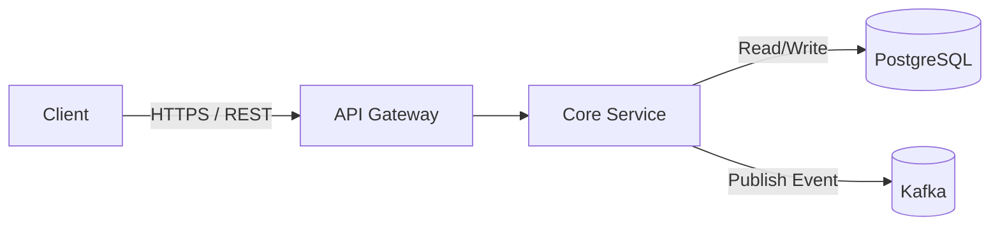
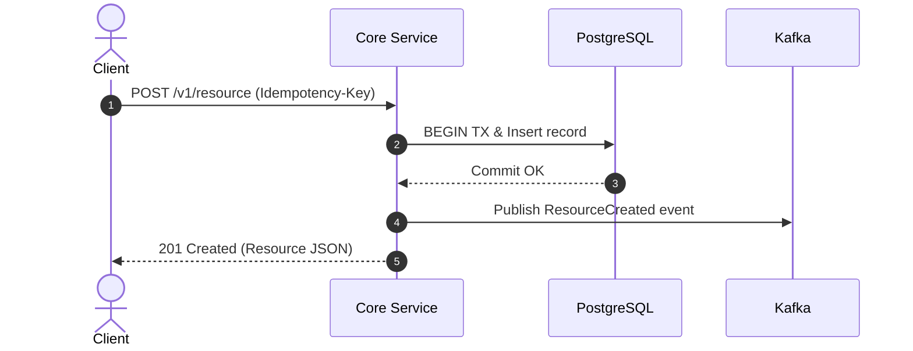

# [FEATURE / SYSTEM NAME] – TECHNICAL SPECIFICATION

- **Status:** Draft | In Review | Approved
- **Author:** [Engineer / Architect Name]
- **Reviewers:** [Tech Lead, Security, DevOps]
- **Target Release:** [Version / Quarter]
- **Last Updated:** [YYYY-MM-DD]

---

## 1. Context & Problem Statement
- **Background:** [2–3 sentences describing the current system state and technical bottleneck.]
- **Problem:** [Specific technical limitation, scaling constraint, or missing capability with quantified impact.]

## 2. Goals & Non-Goals
### Goals
- [Measurable technical goal 1, e.g., Support 2,000 RPS with P99 latency < 150ms]
- [Measurable technical goal 2, e.g., Guarantee zero duplicate charges via Idempotency Keys]

### Non-Goals (Out-of-Scope)
- [Explicit technical exclusion 1, e.g., Multi-region active-active replication in Phase 1]
- [Explicit technical exclusion 2, e.g., Migrating legacy reporting queries off the primary DB]

---

## 3. Proposed Architecture & Data Flow
### 3.1. High-Level Architecture (C4 Container / Component)


### 3.2. Sequence Flow (Happy Path & Async Processing)


---

## 4. Detailed Design
### 4.1. Data Model & Database Schema
- **Storage Engine:** [e.g., PostgreSQL 16]
- **Schema Changes:**
```sql
CREATE TABLE example_resources (
    id UUID PRIMARY KEY DEFAULT gen_random_uuid(),
    tenant_id UUID NOT NULL,
    idempotency_key VARCHAR(64) NOT NULL,
    status VARCHAR(32) NOT NULL,
    created_at TIMESTAMPTZ NOT NULL DEFAULT NOW(),
    CONSTRAINT uq_tenant_idempotency UNIQUE (tenant_id, idempotency_key)
);

CREATE INDEX idx_example_resources_tenant_status ON example_resources (tenant_id, status);
```
- **Migration & Backward Compatibility:** [Expand-and-contract strategy, zero-lock index creation `CREATE INDEX CONCURRENTLY`.]

### 4.2. API Contracts
#### `POST /v1/resources`
- **AuthN/AuthZ:** Bearer JWT; requires scope `resources:write`.
- **Headers:** `Idempotency-Key: <uuid>` (Required).
- **Request Payload:**
```json
{
  "tenant_id": "550e8400-e29b-41d4-a716-446655440000",
  "amount": 150000,
  "currency": "VND"
}
```
- **Response (`201 Created`):**
```json
{
  "id": "9b1deb4d-3b7d-4bad-9bdd-2b0d7b3dcb6d",
  "status": "PENDING",
  "created_at": "2026-11-12T08:00:00Z"
}
```
- **Error Codes:** `400 Bad Request` (validation error), `401 Unauthorized`, `409 Conflict` (idempotency mismatch), `429 Too Many Requests`, `503 Service Unavailable`.

---

## 5. Alternatives Considered & Trade-offs (ADR)
| Option | Approach | Pros | Cons | Decision |
| :--- | :--- | :--- | :--- | :--- |
| **Option A (Selected)** | [e.g., Transactional Outbox + Kafka] | Guarantees at-least-once delivery without dual-write inconsistency | Adds relay worker operational overhead | **Accepted** |
| **Option B** | [e.g., Direct dual-write to DB + Kafka] | Lower initial code complexity | Risk of lost events if Kafka publish fails post-commit | **Rejected** |

---

## 6. Non-Functional Requirements (NFRs)
- **Performance & Scalability:** Service MUST sustain `[X]` RPS with P50 < `[X]`ms and P99 < `[X]`ms. Horizontal auto-scaling triggers at 70% CPU/Memory.
- **Security:** All external traffic MUST use TLS 1.3. PII fields MUST be encrypted at rest (AES-256) and masked in logs.
- **Observability:**
  - **Metrics:** Expose Prometheus metrics (`http_request_duration_seconds`, `kafka_consumer_lag`).
  - **Logging:** Structured JSON logs correlated via `X-Request-ID` / `trace_id`.
  - **Alerting:** PagerDuty alert fires when 5xx error rate exceeds 1% over 5 minutes.

---

## 7. Edge Cases, Failure Modes & Rollback Plan
- **Downstream Timeout / Failure:** External calls MUST enforce a `3,000ms` timeout, retry up to 3 times with exponential backoff + jitter, and trip a Circuit Breaker after 50% failures in 10 seconds.
- **Duplicate Requests:** `POST` endpoints MUST deduplicate requests using `Idempotency-Key` cached in Redis for 24 hours.
- **Deployment & Rollback Plan:**
  - Release behind Feature Flag `[flag_name]` with canary rollout (5% -> 25% -> 100%).
  - **Rollback Trigger:** Error rate > 1% or P99 latency > `[X]`ms for 5 minutes -> Disable feature flag immediately and revert container image to previous stable tag.